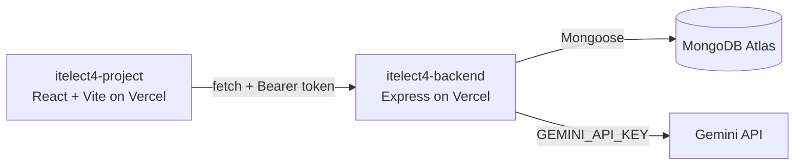

# itelect4-backend

The REST API behind the Event RSVP & Check-In System: Express in TypeScript,
MongoDB Atlas through Mongoose, JWT login, and one route that asks Gemini to
review an event description.

- **Live API:** https://itelect4-backend-brown.vercel.app/api/health
- **Frontend repo:** https://github.com/Rayz-bit/itelect4-project
- **Live site:** https://itelect4-project-phi.vercel.app

## What it does

Organizers publish events and attendees RSVP to them.

| Route | Access | What it does |
|---|---|---|
| `POST /api/auth/register`, `POST /api/auth/login` | Public | Create an account, get a JWT |
| `GET /api/events`, `GET /api/events/:id` | Public | Browse events |
| `POST`, `PUT`, `DELETE /api/events` | Token, owner only | Manage your own events |
| `GET /api/rsvps`, `POST /api/rsvps` | Token | List and create your own RSVPs |
| `POST /api/ai` | Token, 5 a minute | Gemini reviews an event description |

## Architecture

## Run it locally

1. `npm install`
2. Copy `.env.example` to `.env` and fill in `MONGODB_URI`, `JWT_SECRET`,
   `CORS_ORIGIN` (your frontend's address) and `GEMINI_API_KEY`.
3. `npm run seed` once, then `npm run dev`.
4. `npm test` runs the Supertest tests.

## AI use

I used an AI assistant (Claude) while building this project for explanations,
debugging and drafting code. I tested the result and can explain every file.
